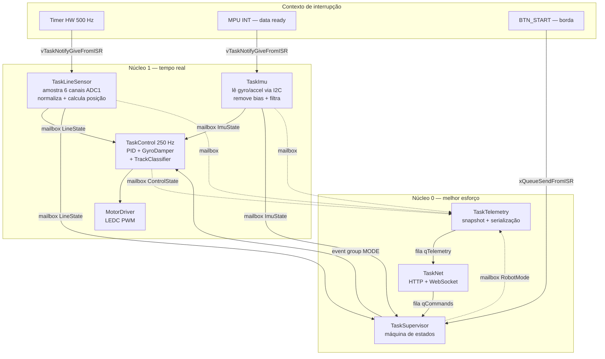
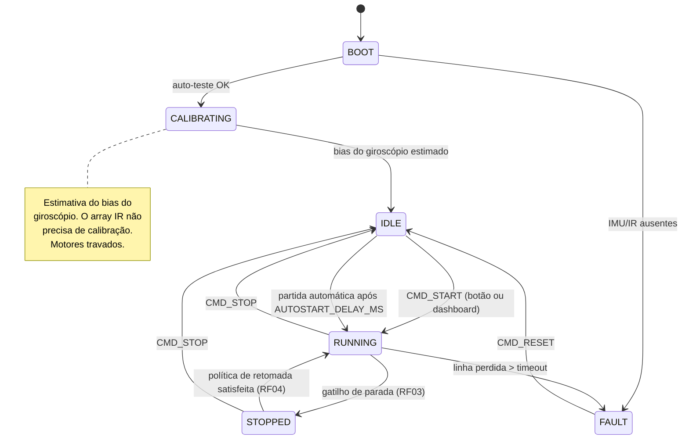

# Arquitetura de Firmware — Robô Seguidor de Linha

> **Status:** plano de arquitetura. Nada implementado ainda — este documento é o
> contrato que a implementação deve seguir.
>
> **Plataforma:** ESP32 (DOIT DevKit v1) · PlatformIO · framework Arduino sobre FreeRTOS
> **Periféricos:** 4 motores DC via driver L298N (canais compartilhados por lado),
> array de sensores IR QTR-8A, IMU MPU-6050 (I2C), Wi-Fi para telemetria e controle.

---

## 1. Requisitos e como a arquitetura os atende

| ID | Requisito | Onde é atendido |
|----|-----------|-----------------|
| RF01 | Navegação autônoma por linha (linha **branca** sobre fundo escuro) | `TaskLineSensor` + `TaskControl` (PID) |
| RF02 | Detecção de marcações laterais | `MarkDetector` — **desativado** atrás de `FEATURE_LATERAL_MARKS` |
| RF03 | Execução de parada | `TaskSupervisor`, estado `STOPPED` |
| RF04 | Retomada de percurso | `ResumePolicy` — por contagem de marcações **ou** por tempo |
| RF05 | Telemetria e monitoramento remoto via Wi-Fi | `TaskTelemetry` + `TaskNet` (WebSocket) |
| RF06 | Controle de estabilidade angular (giroscópio) | `GyroDamper` dentro de `TaskControl` |

### Decisões de projeto já tomadas

1. **Array IR com 6 canais, todos em ADC1.** O ESP32 não consegue usar o ADC2
   enquanto o Wi-Fi está ativo, e o Wi-Fi é requisito (RF05). Os 8 canais do
   QTR-8A não cabem nos 6 pinos de ADC1 disponíveis, então usamos 6 sensores e
   deixamos 2 canais das pontas desconectados. Seis sensores dão resolução
   espacial suficiente com interpolação de posição.
2. **MPU-6050 com dois papéis:** amortecer o zigue-zague em reta (RF06) e
   classificar trecho reto × curva para adaptar ganhos e velocidade base.
3. **Dashboard:** servidor HTTP + WebSocket embarcado no ESP32. O PC só precisa
   de um navegador; o canal é bidirecional (telemetria descendo, comandos subindo).
4. **Parada/retomada:** política dupla. Com marcações laterais habilitadas, a
   contagem de marcações governa o ciclo; sem elas, o ciclo é governado por tempo.
5. **Marcação lateral desacoplada.** `FEATURE_LATERAL_MARKS = 0` por padrão. A
   interface existe, a implementação é um stub, e nenhum outro módulo depende dela
   para funcionar.

---

## 2. Mapa de pinos

Orçamento de GPIO fechado, já considerando a restrição do ADC2.

| Função | GPIO | Observações |
|--------|------|-------------|
| **Motores (L298N)** | | |
| `ENA` — PWM lado esquerdo | 19 | LEDC canal 0 |
| `IN1` — direção esquerda A | 18 | |
| `IN2` — direção esquerda B | 5 | ⚠️ pino de *strapping* (deve estar HIGH no boot); manter o L298N desenergizado ou com pull-up durante o reset |
| `ENB` — PWM lado direito | 4 | LEDC canal 1 |
| `IN3` — direção direita A | 17 | |
| `IN4` — direção direita B | 16 | |
| **Array IR (QTR-8A, 6 canais, ADC1)** | | ordem física esquerda → direita |
| `IR0` | 36 | input-only (SVP) |
| `IR1` | 39 | input-only (SVN) |
| `IR2` | 34 | input-only |
| `IR3` | 35 | input-only |
| `IR4` | 32 | |
| `IR5` | 33 | |
| **IMU (MPU-6050)** | | |
| `SDA` | 21 | I2C0 @ 400 kHz |
| `SCL` | 22 | |
| `MPU_INT` | 23 | **interrupção de data-ready** |
| **Diversos** | | |
| `LED_STATUS` | 2 | LED da placa |
| `BTN_START` | 13 | botão com pull-up interno, **interrupção** por borda de descida |

Pinos livres para expansão futura: 12, 14, 15, 25, 26, 27 (os quatro últimos são
ADC2 — só servem como digitais enquanto o Wi-Fi estiver ligado).

> ⚠️ **Erratum conhecido:** GPIO36 e GPIO39 podem apresentar glitches de leitura
> quando o sensor Hall / ULP é usado. Não usamos nenhum dos dois, então não há
> problema, mas vale registrar caso apareça ruído inexplicado nesses dois canais.

> ⚠️ **Alimentação:** o QTR-8A vai em **3V3**, nunca em 5V — o ADC do ESP32 não
> tolera mais que ~3.3 V na entrada.


### Fatos de montagem, e por que são três flags

O mapa de pinos descreve a **fiação**. Três fatos de **montagem** ficam em
`robot_config.h`, porque não são fiação e esconder qualquer um deles no mapa de pinos
faria uma conferência futura com o multímetro parecer errada:

| Flag | Fato físico | Onde é aplicada |
|---|---|---|
| `MOTOR_L_REVERSED` / `MOTOR_R_REVERSED` | os motores dos dois lados são montados espelhados, então exatamente um lado precisa ter o sentido invertido | `MotorDriver::applySide()` |
| `MOTOR_SIDES_SWAPPED` | os canais do driver atendem os lados trocados, porque a rotulagem original de esquerda/direita foi feita com a outra ponta do robô como frente | `MotorDriver::setSpeed()`, no último passo |
| `IR_REVERSED` | o cabo do array está ligado na ordem inversa à física | `IrArray::sample()` |
| `GYRO_Z_REVERSED` | o MPU-6050 está montado com o eixo Z invertido | `Imu::read()` |

**Por que `MOTOR_SIDES_SWAPPED` é matematicamente necessária.** Com os motores
espelhados, só duas das quatro combinações das flags de inversão produzem translação —
`(true, false)` e `(false, true)` — e elas dão sentidos de marcha opostos. Passar de uma
para a outra nega as duas velocidades de roda ao mesmo tempo, o que nega a diferença
entre elas. E a diferença é a curva. Ou seja: **as duas flags de inversão não conseguem
acertar o sentido de marcha e o sentido de curva ao mesmo tempo.** Uma terceira correção
é obrigatória; a escolha é só onde colocá-la.

---

## 3. Camadas

A arquitetura tem quatro camadas. A regra é que dependências só apontam para
baixo: nenhum driver conhece a aplicação, e o controle não conhece a rede.

```
┌──────────────────────────────────────────────────────────┐
│  net/        WiFiManager · WebServer · WsProtocol        │  Camada de comunicação
├──────────────────────────────────────────────────────────┤
│  app/        Supervisor (FSM) · Telemetry · RobotState   │  Camada de aplicação
├──────────────────────────────────────────────────────────┤
│  control/    PidAlgorithm · LineFollower · GyroDamper    │  Camada de controle
│              TrackClassifier · MarkDetector (stub)       │
├──────────────────────────────────────────────────────────┤
│  hal/        MotorDriver · IrArray · Imu · StatusLed     │  Camada de hardware
├──────────────────────────────────────────────────────────┤
│  config/     board_pins.h · robot_config.h · features.h  │  Configuração
└──────────────────────────────────────────────────────────┘
```

**Por que essa separação importa aqui:** as rotinas de teste (seção 8) compilam
contra `hal/` e `control/` sem arrastar `app/` nem `net/`. Sem essa fronteira, um
teste de motor acabaria puxando o servidor WebSocket junto.

### 3.1 Estrutura de diretórios proposta

```
include/
  config/
    board_pins.h        // mapa de pinos da seção 2                    [etapa 1]
    robot_config.h      // ganhos, períodos, limites, velocidades      [etapa 1]
    features.h          // flags de compilação                         [etapa 1]
  hal/
    motor_driver.h      // 2 lados; setSpeed(left,right) em [-1..1]        [etapa 2]
    ir_array.h          // leitura bruta, limiar fixo, posição da linha    [etapa 2]
    imu.h               // wrapper do MPU6050 + ISR de data-ready          [etapa 2]
    status_led.h        // padrão de pisca por estado                      [etapa 4]
  control/
    pid_algorithm.h     // PID sobre erro, com dt e anti-windup        [etapa 3]
    line_follower.h     // compõe PID + damper + classificador         [etapa 3]
    gyro_damper.h       // amortecimento por taxa angular (RF06)       [etapa 3]
    track_classifier.h  // reta × curva, ganhos interpolados           [etapa 3]
    stop_policy.h       // RF03/RF04 — TimedPolicy ativa                [etapa 4]
    mark_detector.h     // RF02 — stub desativado                       [etapa 4]
  app/
    entry_points.h      // despacho APP_TARGET_* → appSetup/appLoop     [etapa 1]
    robot_app.h         // ponto de entrada do firmware completo        [etapa 1]
    robot_state.h       // structs das mailboxes + enums de modo        [etapa 4]
    supervisor.h        // máquina de estados                           [etapa 4]
    tasks.h             // tarefas, mailboxes, filas, event group, ISRs [etapa 4]
  net/
    wifi_manager.h
    ws_server.h
    protocol.h          // esquema das mensagens JSON
  test/
    test_led.h  test_motors.h  test_imu.h  test_ir.h                    [etapa 1]
    test_wifi.h  test_control.h                                         [etapa 1]
    teleplot.h          // formato de saída serial, header-only           [etapa 1]
src/
  <espelha include/>
  main.cpp              // só chama appSetup/appLoop                    [etapa 1]
test/
  host/                 // verificação de control/ no PC, sob ASan/UBSan [etapa 3]
data/
  index.html            // dashboard servido do LittleFS
docs/
  ARQUITETURA.md        // este documento
```

Os arquivos atuais (`TestLed`, `TestMotors`, `TestI2C`, `testSensorIR`) migram
para `src/test/` com os nomes acima. `pid_algorithm.{h,cpp}` vai para `control/`
praticamente como está.

---

## 4. Modelo de tarefas (FreeRTOS)

O ESP32 tem dois núcleos, e a divisão é deliberada: **núcleo 1 roda o laço de
controle e nada mais**; **núcleo 0 roda rede, telemetria e supervisão**. Isso
garante que uma reconexão de Wi-Fi ou um cliente WebSocket lento não consigam
introduzir jitter na malha de controle.

| Task | Núcleo | Prioridade | Stack | Período / gatilho |
|------|--------|-----------|-------|-------------------|
| `TaskImu` | 1 | 5 | 3072 B | **ISR de data-ready do MPU** (200 Hz) |
| `TaskLineSensor` | 1 | 4 | 3072 B | **ISR de timer de hardware** (500 Hz) |
| `TaskControl` | 1 | 3 | 4096 B | `vTaskDelayUntil`, 250 Hz (4 ms) |
| `TaskSupervisor` | 0 | 3 | 4096 B | `vTaskDelayUntil`, 50 Hz (20 ms) |
| `TaskTelemetry` | 0 | 2 | 4096 B | `vTaskDelayUntil`, 20 Hz (50 ms) |
| `TaskNet` | 0 | 2 | 8192 B | fila de eventos + housekeeping 5 Hz |

> As tasks sensoriais têm prioridade **acima** do controle de propósito: elas são
> curtas e precisam entregar a amostra fresca antes do controle acordar. Se
> `TaskControl` tivesse prioridade maior, leria dados de um ciclo atrasado.

> ⚠️ **O contrapeso dessa escolha é um requisito, não uma otimização.** Como
> `TaskLineSensor` está acima de `TaskControl` no mesmo núcleo, se a amostragem não
> couber no próprio período ela nunca bloqueia — e o controle **simplesmente não roda**.
> Não há erro, não há log: a malha desaparece em silêncio.
>
> Aconteceu de verdade. A primeira versão amostrava a 500 Hz com 4 leituras por canal:
> 24 chamadas a `analogRead()`, a ~60–100 µs cada, dentro de um período de 2 ms. Hoje são
> 250 Hz com 2 leituras, ou 12 conversões por período de 4 ms, e a telemetria publica
> `lineSampleUs` e `lineLoadPct` para que a margem seja observável em vez de presumida.
> **`lineLoadPct` acima de ~80% é sinal de alerta.**

### 4.1 Fluxo de dados



### 4.2 Primitivas de sincronização

> **Publicação incondicional.** `TaskControl` publica `ControlState` em **todo** ciclo,
> inclusive quando falta amostra de sensor — nesse caso com `have_line` em zero e a malha
> não atualizada. A primeira versão abandonava o ciclo quando a mailbox do array estava
> vazia, e o efeito era que qualquer falha a montante chegava à telemetria como zeros,
> indistinguível de "o controle calculou zero". Um estado publicado dizendo "não tenho
> entrada" vale muito mais que estado nenhum.

O padrão dominante é **mailbox**: uma fila de profundidade 1 escrita com
`xQueueOverwrite` e lida com `xQueuePeek`. O produtor nunca bloqueia, o consumidor
sempre pega o valor mais recente, e não existe risco de leitura rasgada de um
struct multi-campo. Para dados de sensor de alta taxa isso é o certo — ninguém
quer processar uma amostra de posição de linha de 40 ms atrás porque ela ficou
enfileirada.

| Primitiva | Nome | Tipo | Papel |
|-----------|------|------|-------|
| Mailbox | `mbLineState` | `xQueueOverwrite` prof. 1 | `TaskLineSensor` → `TaskControl`, `TaskSupervisor`, `TaskTelemetry` |
| Mailbox | `mbImuState` | `xQueueOverwrite` prof. 1 | `TaskImu` → idem |
| Mailbox | `mbControlState` | `xQueueOverwrite` prof. 1 | `TaskControl` → `TaskTelemetry` |
| Mailbox | `mbRobotMode` | `xQueueOverwrite` prof. 1 | `TaskSupervisor` → `TaskTelemetry` |
| Fila | `qCommands` (prof. 8) | `xQueueSend` | `TaskNet` / ISR do botão → `TaskSupervisor` |
| Fila | `qTelemetry` (prof. 4) | `xQueueSend` | `TaskTelemetry` → `TaskNet` |
| Event group | `egRobotMode` | bits `RUN`, `STOP`, `CALIB`, `FAULT` | `TaskSupervisor` → `TaskControl` (mudança de modo sem polling) |
| ~~Mutex~~ | ~~`mxI2C`~~ | — | **Não implementado, e não por esquecimento.** `TaskImu` detém o barramento de ponta a ponta: inicialização, estimativa de bias e leitura periódica acontecem todas nela. Não existe segundo acesso para serializar. Se um dia houver outro periférico I2C, o mutex entra junto com ele |
| Mutex | `mxParams` | `xSemaphoreCreateMutex` | protege os ganhos de PID enquanto o dashboard os reescreve em tempo de execução |
| Notificação | direta à task | `vTaskNotifyGiveFromISR` | ISRs acordando `TaskImu` e `TaskLineSensor` |

**Nota sobre `mxParams`:** o ajuste de PID pelo dashboard acontece no núcleo 0
enquanto o controle roda no núcleo 1. `TaskControl` pega o mutex com timeout zero
e, se falhar, simplesmente reusa a cópia local dos ganhos daquele ciclo. O controle
nunca bloqueia por causa da rede.

### 4.3 Interrupções

Três fontes, todas com ISR mínima (`IRAM_ATTR`, sem alocação, sem `Serial`, sem I2C):

1. **`MPU_INT` (GPIO 23) — data-ready do MPU-6050.** É a interrupção "de sensor"
   principal. O MPU é configurado com `setRate()` para 200 Hz e
   `setIntDataReadyEnabled(true)`. A ISR só faz `vTaskNotifyGiveFromISR(hTaskImu)`.
   A leitura I2C acontece na task, nunca na ISR. Vantagem sobre polling: a amostra
   é lida assim que existe, com jitter mínimo, e o intervalo `dt` da integração do
   giroscópio fica constante — o que importa muito para o termo de amortecimento.

2. **Timer de hardware 0 — cadência de amostragem do array IR (500 Hz).**
   `timerAttachInterrupt` + `vTaskNotifyGiveFromISR(hTaskLineSensor)`. O ADC é lido
   na task. Isso desacopla a taxa de amostragem do escalonador e evita o `delay(100)`
   que o teste atual usa.

3. **`BTN_START` (GPIO 13) — borda de descida com debounce por timestamp na ISR.**
   *Atualmente não compilada:* `FEATURE_AUTOSTART` está ligada e o robô parte sozinho.
   O código segue no lugar, atrás da flag.
   `xQueueSendFromISR(qCommands, CMD_TOGGLE_RUN)`. Serve para armar/desarmar o robô
   sem depender do Wi-Fi.

---

## 5. Camada de controle

### 5.1 Posição da linha

O QTR-8A é analógico e a pista é **linha branca sobre fundo escuro**, ou seja, o
sinal é invertido em relação ao caso mais comum. A cadeia é:

1. **Amostragem:** 6 canais × 4 leituras, média simples (o teste atual já faz isso
   com 8 amostras; 4 basta a 500 Hz).
2. **Classificação por limiar fixo:** leitura acima de `IR_BLACK_THRESHOLD` (4000) é
   fundo escuro, abaixo é linha branca. Não há calibração: a faixa de operação do
   array é conhecida e estável, então não há o que aprender em tempo de execução.
3. **Orientação:** `IR_REVERSED` converte índice de ligação em posição física. Medido na
   bancada: o cabo do array está ligado na ordem inversa à física, e a flag está ligada.
   Sem ela a posição cresceria para o lado errado e o controle corrigiria para longe da
   linha. `raw()` e `onLine()` continuam na ordem de ligação, de propósito, para que
   conferir um canal morto contra `IR_CHANNELS` continue direto.
4. **Posição:** média dos índices físicos dos canais que veem linha,
   `pos = Σ(i · 1000) / n`, dando `0` (extrema esquerda) a `5000` (extrema direita)
   para 6 sensores. O setpoint é o centro, `2500`.
5. **Linha perdida:** se nenhum canal vê linha, `lineDetected` fica falso e a última
   posição válida é mantida — `TaskControl` então faz busca (seção 5.5).

**Consequência do limiar fixo:** a posição é quantizada. Com um ou dois canais sobre
a linha, os valores possíveis são múltiplos de 500 — onze posições discretas na faixa
de 0 a 5000, em vez de um contínuo. Isso torna o termo derivativo calculado sobre a
posição especialmente ruidoso, já que ele derivaria uma escada.

É justamente o que o amortecimento por giroscópio da seção 5.3 resolve: `ωz` mede a
rotação do chassi de forma contínua e não sofre com a quantização, então dá para
manter `Kd` baixo e deixar o amortecimento com `Kg`. A simplificação do sensor
aumenta a importância do RF06, não a diminui.

Se a quantização se mostrar limitante na sintonia, o caminho sem reintroduzir
calibração é normalizar linearmente a leitura bruta contra a faixa fixa `[0, 4000]` em
vez de cortá-la em dois níveis, recuperando a média ponderada contínua. Fica
registrado como alternativa, não como plano.

### 5.2 PID de linha

Reaproveita a classe `PidAlgorithm` existente, com três ajustes necessários:

- **`dt` explícito.** A implementação atual soma o erro direto no integrador e usa
  a diferença bruta como derivada, assumindo passo fixo implícito. Com `TaskControl`
  a 250 Hz o passo é fixo de fato (4 ms), mas passar `dt` deixa o ganho independente
  da taxa e permite mudar a taxa sem reajustar tudo.
- **Anti-windup.** Saturar o integrador e congelá-lo quando a saída está saturada.
  Sem isso, o robô que perde a linha numa curva acumula integral e sai girando.
- **Bugs corrigidos na migração.** Eram **dois** estouros de array, não um. O
  construtor zerava `last_error[i]` para `i < DERIV_AUX_MAX + 1` num array de
  `DERIV_AUX_MAX` posições — escrita fora dos limites. E o cálculo da derivada lia
  `last_error[deriv_aux + 1]` sob a condição `deriv_aux < DERIV_AUX_MAX`, que é
  sempre verdadeira porque `deriv_aux` já vem reduzido módulo o tamanho: com
  `deriv_aux == 19` a leitura caía em `last_error[20]`. Isso também tornava o ramo
  `else` código morto. O índice agora é sempre reduzido módulo o tamanho da janela.

- **Erro em vez de setpoint.** A classe passou a receber o erro diretamente, em vez de
  um par setpoint/medida. O `IrArray` já entrega o erro com sinal definido, e manter um
  setpoint interno criaria um segundo lugar onde a convenção de sinal pode ser
  invertida por engano — que é a forma mais comum de um seguidor de linha corrigir para
  o lado errado.

- **Derivada de janela longa, mantida de propósito.** A intenção da versão original era
  derivar contra uma amostra antiga, não contra a anterior. Com a posição quantizada em
  passos de 500 (seção 5.1) isso é o certo: a diferença entre amostras vizinhas é zero
  quase sempre e dá um salto enorme quando muda. A janela é de
  `PID_DERIVATIVE_WINDOW` amostras, e a divisão é pelo tempo que ela cobre de fato.

A saída do PID é a **ação diferencial** `u`, e a mixagem para os dois lados é:

```
left  = baseSpeed + u
right = baseSpeed - u
```

com saturação simétrica que preserva a diferença: se um lado passa do limite, **os
dois** são deslocados na mesma medida, sacrificando velocidade para manter a curva que
o controle pediu. Cortar cada lado independentemente reduziria a diferença, que é
exatamente a informação de controle.

> **Essa convenção é um invariante, não uma preferência.** Se o robô vira para o lado
> errado, a correção **não** é negar a ação aqui: a `LineFollower` é o algoritmo, e um
> sinal de menos no meio dele não diz nada sobre o hardware que o motivou. Funciona —
> inclusive o amortecimento continua correto, porque negar a ação inteira nega o termo do
> giroscópio junto e o sinal de `ação → guinada física` também vira —, mas quebra quatro
> coisas: a convenção documentada, as asserções de `test/host/test_control.cpp`, o sinal
> de `action` na telemetria usada para sintonia, e o significado de `appliedLeft()` e de
> `MOTOR_TRIM`. O lugar da correção é `MOTOR_SIDES_SWAPPED`, na seção 2.

**Convenção de sinal**, o ponto onde um seguidor de linha costuma fugir da linha em vez
de voltar para ela:

| Situação | `line_error` | ação `u` | efeito |
|---|---|---|---|
| Linha à direita do array (robô à esquerda dela) | positivo | positivo | esquerda acelera, robô vira à direita |
| Linha à esquerda do array | negativo | negativo | direita acelera, robô vira à esquerda |

**Normalização dos sinais.** Todos os ganhos são adimensionais e agem sobre sinais em
`[-1, 1]`: o erro de posição é dividido por `LINE_ERROR_SCALE` (2500, a meia faixa do
array) e a taxa angular por `GYRO_RATE_REFERENCE` (300 °/s). Sem isso, `Kp` estaria em
"velocidade por unidade de posição de array" e `Kg` em "velocidade por grau por
segundo" — grandezas incomparáveis, números que não dizem nada a quem sintoniza e
sliders de dashboard sem faixa sensata.

### 5.3 Amortecimento por giroscópio — RF06

O problema do zigue-zague é clássico: o array IR dá uma medida **discreta e ruidosa**
da posição, então o termo derivativo calculado sobre ela precisa de um `Kd` alto que
amplifica ruído, ou de um `Kd` baixo que não amortece. O giroscópio resolve isso
porque mede diretamente a grandeza que queremos amortecer — a velocidade angular do
chassi — de forma contínua e com pouco ruído.

A lei de controle passa a ser:

```
u = Kp·e + Ki·∫e·dt + Kd·(de/dt) − Kg·ωz
```

onde `ωz` é a taxa de guinada em °/s vinda do MPU-6050. O sinal negativo é o que
faz o amortecimento: se o robô está girando para a direita, o termo subtrai da ação
e freia a rotação. Na prática, com `Kg` bem ajustado dá para **reduzir muito o `Kd`
do IR**, que é justamente a fonte do ruído. É um amortecimento de velocidade real,
não uma derivada numérica de um sinal quantizado.

Pré-processamento obrigatório do `ωz`:

- **Remoção de bias:** média de ~500 amostras com o robô parado, na inicialização,
  subtraída de toda leitura. O MPU-6050 tem drift de offset significativo e sem isso
  o robô desenvolve uma tendência lateral constante.
- **Filtro passa-baixa:** DLPF do próprio MPU em ~42 Hz, mais um IIR de primeira
  ordem no firmware se ainda houver ruído.
- **Fundo de escala:** `MPU6050_GYRO_FS_500` (±500 °/s). O ±250 do teste atual satura
  em curva fechada num robô rápido.
- **Orientação:** `GYRO_Z_REVERSED`, aplicada **na classe `Imu`** e não em quem consome o
  valor. Medido na bancada: o sensor está montado com o eixo Z invertido em relação ao
  robô, e a flag está ligada.

  A primeira versão aplicava a inversão dentro do `GyroDamper`. Era um erro de projeto:
  `Imu::yawRate()` continuava devolvendo o sinal cru, então a telemetria mostrava um
  valor e o controle usava outro. Ligar a flag corrigia o amortecimento **sem mudar nada
  no gráfico**, o que torna a conferência na bancada impossível — exatamente a conferência
  que a flag existe para permitir. Com a inversão na fonte há uma única definição:
  `yawRate()` positivo é sempre guinada no sentido horário.

### 5.4 Classificador reta × curva e ganhos adaptativos

Um seguidor de linha com ganho único é ou lento na reta ou instável na curva. Com o
giroscópio dá para saber em qual dos dois regimes o robô está e trocar os parâmetros.

O classificador mantém a média de `|ωz|` numa janela de ~150 ms e aplica **histerese**
(dois limiares, não um) para não ficar oscilando entre os regimes:

| Regime | Condição | Ação |
|--------|----------|------|
| `STRAIGHT` | `|ωz|_méd < θ_baixo` por N ciclos | sobe `baseSpeed`, reduz `Kp`, aumenta `Kg` |
| `CURVE` | `|ωz|_méd > θ_alto` | reduz `baseSpeed`, aumenta `Kp`, reduz `Kg` |

A média é um **filtro exponencial** com constante de tempo de `REGIME_WINDOW_MS`, e não
uma média móvel com fila. Para esta finalidade os dois se comportam praticamente igual,
e o exponencial não precisa de buffer dimensionado pela taxa de controle: mudar
`CONTROL_HZ` não altera a janela de tempo efetiva, que é o que se quer especificar.

A transição entre os conjuntos de ganhos é **interpolada** ao longo de
`REGIME_BLEND_MS`, não abrupta — degrau de ganho em malha fechada gera solavanco. O
classificador expõe um fator `blend` de 0 (reta) a 1 (curva) que caminha em direção ao
regime alvo, e os ganhos, junto com a velocidade base, são interpolados linearmente
entre os dois conjuntos usando esse fator.

O classificador **nasce em `CURVE`**, o conjunto conservador: partir do regime de reta
faria o robô sair acelerado antes de existir qualquer medida de `|ωz|` que justificasse
isso.

Todos os limiares e os dois conjuntos de ganhos são ajustáveis pelo dashboard em
tempo de execução, o que torna a sintonia um processo de minutos em vez de um ciclo
de recompilar-e-regravar a cada tentativa.

### 5.5 Recuperação de linha perdida

Quando `lineLost` fica verdadeiro, `TaskControl` entra numa busca simples: mantém a
última ação diferencial conhecida (o robô estava virando para algum lado quando
perdeu a linha, então continua virando para lá) com velocidade base reduzida, por no
máximo `LINE_LOST_TIMEOUT_MS`. Estourando o timeout, o supervisor leva o robô para
`FAULT` e para os motores.

---

## 6. Máquina de estados (TaskSupervisor)



> ⚠️ **`FEATURE_AUTOSTART` está ligada.** O robô sai de `IDLE` para `RUNNING` sozinho,
> `AUTOSTART_DELAY_MS` após ficar pronto, e a ISR do botão não é compilada. Do energizar
> ao arrancar são ~5,5 s: ~2,5 s de estimativa de bias do giroscópio mais os 3 s de
> contagem. O atraso é contado da entrada em `IDLE`, e não do boot, porque contado do
> boot sobraria meio segundo depois da estimativa — sem tempo de apoiar o robô e afastar
> a mão.
>
> A partida automática vale para `IDLE`, **não** para `FAULT`: um robô que saiu da pista
> não volta a andar sozinho, só depois de um `CMD_RESET`. Mas um reset o devolve a
> `IDLE`, e de lá ele arranca de novo em 3 s.
>
> Desligar a flag devolve o comportamento manual, com botão. É o único lugar a mexer.

`TaskControl` observa `egRobotMode` e só aciona os motores em `RUNNING`. Em qualquer
outro estado a saída é forçada a zero — a parada é feita na camada que aciona os
motores, não por convenção entre tasks.

### 6.1 Gatilho de parada e política de retomada (RF03/RF04)

O ciclo parar–retomar é encapsulado numa interface `StopPolicy` com duas
implementações selecionadas em tempo de compilação:

```cpp
// control/stop_policy.h
class StopPolicy {
 public:
  virtual bool shouldStop(const RobotState& s) = 0;   // RF03
  virtual bool shouldResume(const RobotState& s) = 0; // RF04
  virtual void onLapEvent() = 0;
};
```

| Implementação | Ativa quando | `shouldStop` | `shouldResume` |
|---------------|--------------|--------------|----------------|
| `MarkCountPolicy` | `FEATURE_LATERAL_MARKS == 1` | contagem de marcações atinge `LAPS_TARGET` | contagem de marcações após a parada atinge o alvo seguinte |
| `TimedPolicy` (**padrão**) | `FEATURE_LATERAL_MARKS == 0` | tempo em `RUNNING` ≥ `RUN_DURATION_MS` | tempo em `STOPPED` ≥ `STOP_DURATION_MS` |

Ambos os tempos e o alvo de voltas são parâmetros expostos no dashboard e
persistidos em NVS. Trocar de política não toca em nenhum outro módulo — é essa a
razão da interface existir mesmo com uma das duas desligada.

**`lap_count` e `stop_count` são contadores distintos.** O primeiro é alimentado
exclusivamente pelo `MarkDetector`, então fica sempre em zero com `FEATURE_LATERAL_MARKS`
desligada, como a seção 6.2 exige. O segundo conta ciclos parar–retomar concluídos e é o
que permite validar RF03 e RF04 sem a marcação lateral. Incrementar `lap_count` na
retomada seria mais simples e estaria errado: faria a telemetria reportar voltas que o
robô não deu.

### 6.2 RF02 — marcação lateral, desacoplada

`FEATURE_LATERAL_MARKS` é `0` por padrão. Com a flag em zero:

- `MarkDetector::update()` é um stub que não faz nada e sempre devolve "sem marcação";
- `MarkCountPolicy` nem é compilada;
- nenhum sensor adicional é alocado, nenhum pino é reservado;
- a telemetria envia `lapCount: null`, e o dashboard esconde o painel de voltas.

Quando e se a funcionalidade for implementada, o caminho é: dedicar 1 ou 2 dos canais
das pontas do array (ou um sensor IR lateral extra em um dos pinos livres) e
implementar `MarkDetector` como um detector de borda com debounce espacial. A única
mudança fora do módulo é ligar a flag.

---

## 7. Camada de rede — dashboard Wi-Fi (RF05)

### 7.1 Topologia

O ESP32 roda em **modo STA** conectado à rede local (com fallback para **AP** com
SSID próprio se a conexão falhar em `WIFI_CONNECT_TIMEOUT_MS` — indispensável no
laboratório, onde a rede da instituição costuma ser hostil a dispositivos novos).

Componentes:

- **`ESPAsyncWebServer`** servindo o dashboard (`index.html` + CSS + JS) a partir do
  **LittleFS**, gravado com `pio run -t uploadfs`.
- **`AsyncWebSocket`** em `/ws`, canal bidirecional único.
- **mDNS** respondendo em `http://rastro.local` para não depender de descobrir o IP.

O `AsyncWebServer` roda no próprio contexto do stack TCP/IP; `TaskNet` faz apenas a
ponte entre as filas do firmware e os callbacks do WebSocket, e o housekeeping de
reconexão.

### 7.2 Protocolo

JSON sobre WebSocket. Compacto o suficiente para 20 msg/s sem pressionar a heap, e
legível o bastante para depurar com o navegador aberto.

**Telemetria (ESP32 → PC), 20 Hz nominal:**

```jsonc
{
  "t": 123456,              // millis()
  "mode": "RUNNING",        // estado da FSM
  "line": {
    "pos": 2480,            // 0..5000, setpoint 2500
    "err": 20,
    "lost": false,
    "raw": [120, 340, 890, 910, 350, 130]
  },
  "imu": {
    "gz": -3.2,             // °/s, com bias removido
    "heading": 12.4,        // ângulo integrado, °
    "ax": 0.02, "ay": 0.98
  },
  "ctrl": {
    "u": 0.14,              // ação diferencial
    "p": 0.10, "i": 0.01, "d": 0.02, "g": -0.01,  // contribuição de cada termo
    "left": 0.62, "right": 0.34,
    "regime": "STRAIGHT"
  },
  "lapCount": null,         // null enquanto RF02 estiver desligado
  "health": { "heap": 184320, "rssi": -58, "loopHz": 249 }
}
```

O campo `ctrl` traz a **contribuição de cada termo separada**, não só a saída total.
Sintonizar PID vendo só `u` é adivinhação; vendo P, I, D e G lado a lado dá para
identificar na hora qual termo está dominando ou explodindo.

**Comandos (PC → ESP32):**

```jsonc
{ "cmd": "start" }
{ "cmd": "stop" }
{ "cmd": "reset" }
{ "cmd": "set_pid", "regime": "straight", "kp": 0.8, "ki": 0.0, "kd": 0.05, "kg": 0.3 }
{ "cmd": "set_speed", "base": 0.55 }
{ "cmd": "set_policy", "runMs": 30000, "stopMs": 3000 }
{ "cmd": "save" }        // persiste os parâmetros correntes em NVS
{ "cmd": "telemetry_rate", "hz": 50 }
```

### 7.3 Dashboard

Página única, sem dependências externas (tudo embarcado no LittleFS — não há internet
garantida no laboratório):

- **Gráfico rolante** de posição da linha, erro e `ωz` no tempo;
- **Barras** dos 6 canais IR crus, com o limiar marcado — serve para conferir à
  distância que `IR_BLACK_THRESHOLD` continua com folga dos dois lados;
- **Indicadores** de modo, regime (reta/curva), PWM de cada lado, heap, RSSI;
- **Controles** de start/stop/reset;
- **Sliders** de Kp/Ki/Kd/Kg por regime e de velocidade base, com botão "salvar em NVS";
- **Botão de gravar sessão** exportando CSV do buffer para análise posterior.

### 7.4 Isolamento de falhas

Requisito firme: **nenhuma falha de rede pode afetar o controle**. Concretamente:

- Todo o código de rede vive no núcleo 0;
- `TaskTelemetry` escreve em `qTelemetry` com timeout **zero** — fila cheia significa
  amostra descartada, nunca task bloqueada;
- Perda de Wi-Fi não muda o estado da FSM; o robô continua o percurso;
- Comandos chegam por fila, aplicados só em pontos seguros do ciclo do supervisor;
- Reconexão com backoff exponencial, sem `delay()` bloqueante.

---

## 8. Rotinas de teste compiláveis separadamente

Cada componente tem uma rotina independente, selecionada por **ambiente do PlatformIO**.
Isso é melhor que comentar linhas no `main.cpp` (o que o projeto faz hoje) por três
motivos: o binário de teste não carrega o código do firmware completo, dá para ter
flags e `lib_deps` diferentes por teste, e o comando de build é auto-documentado.

### 8.1 Seleção por ambiente

```ini
[platformio]
default_envs = firmware

[env]
platform = espressif32
board = esp32doit-devkit-v1
framework = arduino
upload_port = /dev/ttyUSB0
monitor_speed = 115200
build_flags = -Wall

[env:firmware]
build_flags = ${env.build_flags} -D APP_TARGET_MAIN
lib_deps = MPU6050
build_src_filter = -<*> +<main.cpp> +<app/robot_app.cpp>

[env:test_motors]
build_flags = ${env.build_flags} -D APP_TARGET_TEST_MOTORS
build_src_filter = -<*> +<main.cpp> +<test/test_motors.cpp>

[env:test_ir]
build_flags = ${env.build_flags} -D APP_TARGET_TEST_IR
build_src_filter = -<*> +<main.cpp> +<test/test_ir.cpp>

; ... idem para test_led, test_imu, test_wifi e test_control
```

Os `build_src_filter` crescem junto com o roteiro: a etapa 2 acrescenta os
arquivos de `hal/` aos ambientes que os usam, a etapa 3 acrescenta `control/`,
e assim por diante. Cada ambiente compila exatamente o que exercita — o binário
de `test_led` não contém driver de motor, e nenhum teste contém o servidor
WebSocket.

E o `main.cpp` fica reduzido a um despachante:

```cpp
#include <Arduino.h>
#include "app/entry_points.h"

void setup() { appSetup(); }   // resolvido em tempo de compilação pela flag
void loop()  { appLoop();  }
```

Comandos:

```bash
pio run -e test_ir -t upload && pio device monitor -e test_ir
```

### 8.2 Escopo de cada rotina

| Ambiente | O que exercita | Como visualizar |
|----------|----------------|-----------------|
| `test_led` | GPIO básico, prova que a placa grava e roda | LED da placa + série `led` |
| `test_motors` | LEDC PWM, sentido de rotação, faixa útil de duty, e **qual lado é qual** | Série `duty` + observação das rodas |
| `test_ir` | 6 canais ADC1, limiar fixo, cálculo de posição | Séries `raw0`..`raw5`, `threshold`, `position` |
| `test_imu` | I2C, **interrupção de data-ready**, bias, taxa efetiva em Hz | Séries `gyroZ`, `acc*`, `heading` |
| `test_wifi` | conexão STA, fallback AP, mDNS, WebSocket com telemetria sintética | Navegador + painel de log |
| `test_control` | malha fechada com o `MotorDriver` **fora do binário**: emite a ação do PID sem mover o robô | Séries `error`, `action`, `pTerm`/`iTerm`/`dTerm`, `gyroTerm`, `blend` |

### 8.3 Formato de saída serial

Visualizador único para todos os testes: a extensão **Teleplot** do VSCode. Ela
plota as linhas que começam com `>` e joga as demais num painel de log, então
texto corrido e dados plotados convivem na mesma porta sem se atrapalhar — não
é preciso escolher entre "monitor legível" e "gráfico".

O formato fica num só lugar, `include/test/teleplot.h`, e os testes chamam
`teleplot::send()`:

```cpp
teleplot::send("S0", (int32_t)412);            // >S0:1204:412
teleplot::send("gyroZ", -87.4f, "deg/s");      // >gyroZ:1204:-87.400§deg/s
```

Duas decisões embutidas no helper:

- **Timestamp de `millis()` em toda amostra.** Sem ele o Teleplot usa a hora de
  chegada do dado no computador, que embute a latência da serial e do buffer do
  sistema operacional. Como boa parte do que se olha aqui é comportamento
  temporal — oscilação, atraso da malha, taxa efetiva do sensor —, um eixo de
  tempo distorcido levaria a conclusões erradas na sintonia.
- **Unidade junto do valor.** O Teleplot separa as séries por unidade no eixo,
  o que evita que aceleração em `g` e taxa angular em `deg/s` acabem no mesmo
  gráfico com escalas incompatíveis.

**Como usar:** instalar a extensão Teleplot, gravar com `pio run -e <alvo> -t
upload` e rodar *Teleplot: Connect to Serial Port* na paleta de comandos,
escolhendo a porta e 115200 baud.

> ⚠️ O Teleplot abre a porta em modo exclusivo. Não dá para deixar o
> `pio device monitor` aberto ao mesmo tempo — feche um antes de abrir o outro,
> senão a porta aparece como ocupada e a gravação falha.

### 8.4 Verificação de host

A camada `control/` não depende de nada do Arduino — é matemática sobre floats. Isso
permite compilá-la no PC e verificar o comportamento sem a placa:

```bash
./test/host/run.sh
```

São duas suítes, ambas com `AddressSanitizer`, `UndefinedBehaviorSanitizer` e
`-fsanitize=bounds-strict`, rodando juntas em poucos segundos:

| Suíte | Cobre |
|---|---|
| `test_control.cpp` | sinais e antissimetria da ação, derivada sobre rampa e sobre erro constante, integral escalada por `dt`, teto do integrador, anti-windup travando sob saturação **e** liberando quando o erro inverte, congelamento da ação e do integrador com a linha perdida, histerese do classificador, taxa de interpolação dos ganhos |
| `test_supervisor.cpp` | transições da FSM da seção 6, precedência da falha por linha perdida sobre a parada programada, isolamento de `FAULT` (só sai por reset), e **as durações medidas** de RF03 e RF04 |

A verificação da FSM é possível porque `update()` recebe o relógio por parâmetro, em vez
de chamar `millis()` internamente. Isso parece um detalhe de estilo, mas é o que permite
medir RF03 e RF04 com tempo simulado e de forma determinística, em segundos, em vez de
cronometrar o robô na pista. As suítes medem a **duração** de cada estado e a comparam
com o prazo configurado, em vez de checar "antes do prazo ainda está parado" — uma
checagem desse tipo passaria com qualquer prazo maior que a margem escolhida.

O `bounds-strict` é o que detecta estouro em array membro de classe — o `AddressSanitizer`
sozinho não pega esse caso, porque o acesso cai dentro do mesmo objeto. Foi exatamente o
defeito da versão original do `PidAlgorithm`, e é o motivo de essa flag estar ligada.

Isto complementa, e não substitui, o `test_control` na placa: o host verifica a
matemática, a placa verifica a integração com os sensores reais e a orientação física
dos sinais.

**Regra de ouro:** nenhum `Serial.print` dentro de ISR, e nenhum em `TaskControl`.
No firmware completo, `TaskTelemetry` é a **única** tarefa que imprime.

Isso também é o que tornou desnecessário o `SerialMutex.h` que existia no projeto, e
que foi removido na etapa 4: ele declarava um `extern` sem definição — qualquer arquivo
que o incluísse falharia na ligação. Com um único escritor, não há o que serializar.

---

## 9. Configuração e persistência

`config/robot_config.h` centraliza tudo que é ajustável, com os valores de compilação
servindo apenas de **padrão de fábrica** — os valores efetivos vêm da NVS, e o
dashboard os reescreve em tempo de execução.

```cpp
// valores de partida, a serem sintonizados na pista
namespace cfg {
  constexpr uint32_t CONTROL_HZ        = 250;
  constexpr uint32_t IR_SAMPLE_HZ      = 500;
  constexpr uint32_t IMU_SAMPLE_HZ     = 200;
  constexpr uint32_t TELEMETRY_HZ      = 20;

  constexpr float    BASE_SPEED        = 0.50f;   // 0..1
  constexpr float    MAX_SPEED         = 0.95f;

  // regime reta
  constexpr float    KP_STRAIGHT       = 0.60f;
  constexpr float    KI_STRAIGHT       = 0.00f;
  constexpr float    KD_STRAIGHT       = 0.02f;
  constexpr float    KG_STRAIGHT       = 0.35f;   // amortecimento por giro

  // regime curva
  constexpr float    KP_CURVE          = 1.10f;
  constexpr float    KI_CURVE          = 0.00f;
  constexpr float    KD_CURVE          = 0.05f;
  constexpr float    KG_CURVE          = 0.15f;

  constexpr float    GYRO_TH_LOW       = 25.0f;   // °/s — entra em STRAIGHT
  constexpr float    GYRO_TH_HIGH      = 60.0f;   // °/s — entra em CURVE

  constexpr uint32_t RUN_DURATION_MS   = 30000;   // TimedPolicy
  constexpr uint32_t STOP_DURATION_MS  = 3000;
  constexpr uint32_t LINE_LOST_TIMEOUT_MS = 400;
}
```

Persistência em NVS (namespace `rastro`): bias do giroscópio,
ganhos dos dois regimes, velocidade base, parâmetros da política de parada,
credenciais de Wi-Fi.

---

## 10. Segurança operacional

| Risco | Mitigação |
|-------|-----------|
| Firmware trava com motores ligados | Task watchdog do ESP32 armado em `TaskControl`; o reset deixa os pinos em alta impedância e o L298N para |
| `TaskControl` perde o deadline | Contador de deadlines perdidos publicado na telemetria (`loopHz`); degradação visível em vez de silenciosa |
| Robô sai da pista | `LINE_LOST_TIMEOUT_MS` → estado `FAULT` → motores em zero |
| Queda de bateria sob carga | Detecção de brownout do ESP32 + log da causa do reset no boot |
| Comando perigoso pela rede | Comandos só aplicados em `TaskSupervisor`, em pontos seguros do ciclo; `start` nunca é aceito nos estados `FAULT` ou `CALIBRATING` |
| Motores acionados fora de `RUNNING` | `MotorDriver` nasce desarmado e ignora `setSpeed()` até um `arm()` explícito do supervisor |

---

## 11. Roteiro de implementação

Ordem pensada para que cada etapa seja testável sozinha antes da seguinte depender dela.

**Etapa 1 — Fundação** ✅ concluída
1. ✅ Reorganizar diretórios conforme 3.1; mover os testes existentes.
2. ✅ Criar `config/board_pins.h`, `robot_config.h`, `features.h`.
3. ✅ Reescrever `platformio.ini` com os ambientes de 8.1.
4. ✅ Validar: os sete ambientes compilam sem warnings com `-Wall`.

   Correções feitas no caminho: `TestMotors` definia `testMotorSetup` enquanto o
   cabeçalho declarava `testMotorsSetup`, e o teste nunca teria linkado; o teste
   de IR passou dos 8 canais (quatro em ADC2) para os 6 de ADC1, o que tornou
   desnecessário o `WiFi.mode(WIFI_OFF)`; o teste de IMU passou o fundo de escala
   do giroscópio de ±250 para ±500 °/s.

   Pendente de bancada: rodar `test_led` e `test_motors` na placa para confirmar
   qual lado físico responde a qual canal do driver e medir a zona morta.

**Etapa 2 — HAL** ✅ concluída
5. ✅ `MotorDriver` sobre LEDC, com `setSpeed(left, right)` em `[-1, 1]` e trava de segurança.
6. ✅ `IrArray` com os 6 canais de ADC1, classificação por limiar fixo e cálculo de posição.
7. ✅ `Imu` com interrupção de data-ready, remoção de bias e filtro.
8. ✅ Validar: os sete ambientes compilam sem warnings; `test_motors`, `test_ir` e
   `test_imu` reescritos para exercitar a HAL pela mesma interface que o controle usará.

   Dois defeitos corrigidos durante a implementação:

   - **Frenagem do L298N.** `stop(BRAKE)` colocava as duas entradas de direção no
     mesmo nível mas zerava o PWM. Com a habilitação em zero a ponte fica em alta
     impedância e o motor gira livre — exatamente o oposto de frear. O modo de
     frenagem agora leva o duty ao máximo.
   - **Espera da IMU.** O laço de espera do data-ready usava `taskYIELD()`, que só
     cede para tarefas de prioridade igual ou maior. A tarefa ociosa nunca rodaria e
     o watchdog resetaria a placa durante a estimativa de bias, que leva ~2,5 s.
     Trocado por `vTaskDelay(1)`.

   **Simplificação posterior:** a calibração do `IrArray` foi removida. A faixa de
   operação do array é conhecida e estável, então a classificação passou a ser por
   limiar fixo em `IR_BLACK_THRESHOLD` (4000) — some o estado de varredura, o struct
   de extremos, a persistência em NVS e o modo degradado de "não calibrado". O custo
   é a quantização da posição, discutida na seção 5.1.

   **Achado de bancada:** os dois lados são montados espelhados no chassi, então a
   mesma polaridade elétrica gira os motores em sentidos opostos em relação à frente
   do robô — com comando positivo, o lado esquerdo ia para trás. Compensado por
   `MOTOR_L_REVERSED` e `MOTOR_R_REVERSED`, aplicadas no `MotorDriver`. A correção
   ficou na configuração e não trocando `MOTOR_L_IN1` com `MOTOR_L_IN2` no mapa de
   pinos, que precisa continuar descrevendo a fiação real.

   Pendente de bancada: conferir que `rateHz` no `test_imu` fica próximo dos 200 Hz
   configurados, o que é a prova de que a interrupção de data-ready está de fato
   chegando; e conferir no `test_ir` que o limiar de 4000 cai numa folga clara entre
   os dois patamares de leitura.

**Etapa 3 — Controle** ✅ concluída
9. ✅ `PidAlgorithm` migrado: **dois** estouros de array corrigidos (não um), `dt`
   explícito, anti-windup por travamento condicional, e passou a operar sobre erro em
   vez de setpoint/medida.
10. ✅ `LineFollower` compondo PID, amortecimento e classificador, com mixagem de
    saturação que preserva a diferença entre os lados e a busca por linha perdida.
11. ✅ `GyroDamper` e `TrackClassifier` com histerese e ganhos interpolados.
12. ✅ Validar: `test_control` reescrito com o `MotorDriver` fora do binário, mais uma
    suíte de 33 verificações de host sob sanitizadores (`./test/host/run.sh`, seção 8.4).

    **Decisão de unidades:** todos os ganhos passaram a ser adimensionais, agindo sobre
    sinais normalizados em `[-1, 1]`. Os valores de `robot_config.h` não faziam sentido
    dimensional antes disso — `KP_STRAIGHT = 0.60` aplicado a um erro de ±2500 daria
    ação de ±1500 numa saída que vai de -1 a 1.

    **Sinais conferidos na bancada:** os dois estavam invertidos, e os dois foram
    corrigidos por flag de configuração — `GYRO_Z_REVERSED` e `IR_REVERSED`, ambas
    ligadas. A conferência também expôs um erro de projeto: `GYRO_Z_REVERSED` era
    aplicada no `GyroDamper`, então a série `yawRate` da telemetria não mudava ao ligar a
    flag. Movida para a classe `Imu`.

**Etapa 4 — RTOS e aplicação** ✅ implementada, validação na pista pendente
13. ✅ Tasks, mailboxes, filas, event group e as três ISRs da seção 4.
14. ✅ `Supervisor` com a FSM da seção 6, `TimedPolicy` e `StatusLed`.
15. ⏳ Validar na pista: RF01, RF03 e RF04. A lógica de RF03/RF04 está verificada no
    host com tempo simulado (durações medidas de 30000 ms e 3000 ms), mas seguir a linha
    só se confirma com o robô andando.

    **Decisões tomadas na implementação:**

    - **Inicialização da IMU mora na `TaskImu`.** O `begin()` e a estimativa de bias
      rodam dentro dela, antes do laço, e o supervisor só observa o resultado por um
      enum. A alternativa óbvia — supervisor chamando `calibrateGyroBias()` — faria dois
      núcleos conversarem com o mesmo barramento I2C ao mesmo tempo. É também o que
      tornou o mutex `mxI2C` desnecessário.
    - **Armamento tratado na borda.** `TaskControl` detecta a transição para `RUNNING` e
      chama `follower.reset()` antes de armar. Sem isso, o integral acumulado antes da
      parada seria aplicado de uma vez na retomada do RF04.
    - **Debounce do botão com `xTaskGetTickCountFromISR()`**, não `millis()`: `millis()`
      resolve para uma função que pode não estar em IRAM, e chamá-la de dentro de uma ISR
      trava a placa se a flash estiver ocupada — o que passa a acontecer de fato quando a
      etapa 6 gravar em NVS.
    - **`FEATURE_AUTOSTART`**, ligada por ora: o robô arranca sozinho 3 s depois de
      ficar pronto e a lógica do botão sai do binário. Um interruptor único em vez de
      duas flags, porque os dois modos são mutuamente exclusivos na prática — ou o robô
      espera comando, ou não espera.
    - **`StatusLed`** indica o estado por padrão de pisca. A validação de RF03 e RF04
      acontece com o robô na pista, longe do cabo serial e antes de o dashboard existir;
      sem indicador local não há como distinguir "parou porque a política decidiu" de
      "parou porque entrou em falha".

**Etapa 5 — Rede**
16. `WiFiManager` com STA + fallback AP + mDNS.
17. Servidor HTTP + WebSocket, `TaskTelemetry` e `TaskNet`.
18. Dashboard no LittleFS.
19. Validar: telemetria ao vivo e sintonia de PID pelo navegador (RF05).

**Etapa 6 — Sintonia e refino**
20. Sintonizar os dois regimes na pista usando o dashboard.
21. Ajustar `Kg` até eliminar o zigue-zague na reta (RF06).
22. Persistência em NVS, watchdog, tratamento de falhas.

**Etapa 7 — Opcional, se houver tempo**
23. Implementar `MarkDetector` e ligar `FEATURE_LATERAL_MARKS` (RF02), trocando para `MarkCountPolicy`.

---

## 12. Pendências e pontos em aberto

### Resolvidas na bancada (etapa 2)

- ~~**Sensores das pontas.**~~ Os dois canais das pontas externas ficam desconectados,
  mantendo os seis centrais equidistantes e simétricos em torno do eixo do robô.
- ~~**Frequência de PWM.**~~ **5 kHz**, meio-termo entre o ~1 kHz (mais torque em baixa
  rotação, audível) e o ~20 kHz (silencioso, perde torque). Tira o chiado da faixa mais
  incômoda sem sacrificar torque na partida.
- ~~**Zona morta dos motores.**~~ Medida em **0,65** e compensada no `MotorDriver`.
- ~~**Orientação do array IR.**~~ O cabo está ligado na ordem inversa à física.
  Corrigido por `IR_REVERSED`, aplicada na conversão de índice para posição.
- ~~**Orientação do giroscópio.**~~ O MPU-6050 está montado com o eixo Z invertido em
  relação ao robô. Corrigido por `GYRO_Z_REVERSED`, aplicada na classe `Imu`.
- ~~**Descasamento entre os lados.**~~ Não há descasamento significativo; `MOTOR_TRIM`
  fica em zero. O mecanismo permanece no `MotorDriver` porque o descasamento tende a
  aparecer com o desgaste e com a queda de tensão da bateria, e aí é ajustável pelo
  dashboard sem recompilar.

> ⚠️ **A zona morta de 0,65 merece atenção.** Significa que só 35% da faixa de PWM
> produz movimento, e é sintoma de tensão insuficiente chegando aos motores — coerente
> com a queda de ~2,5 V do L298N alimentado a 5 V. A compensação no `MotorDriver`
> resolve o problema de controlabilidade, mas não o de autoridade: a velocidade máxima
> real do robô fica limitada. Se a alimentação for revista (9 V na entrada do driver via
> PD trigger, ou troca por uma ponte de MOSFET tipo TB6612FNG, que além de não esquentar
> elimina a queda), a zona morta cai bastante e a resolução de controle melhora junto.
> **Remedir depois de qualquer mudança na alimentação.**

**Rampa de aceleração: descartada.** Chegou a existir no `MotorDriver` como limitador
de taxa de variação, para espalhar no tempo o degrau de corrente da partida. Foi
removida por três razões:

1. **Não suavizava o degrau que importa.** A compensação de zona morta é descontínua em
   zero — o primeiro tick fora do repouso já produz `duty = 0,65 + 0,35·0,016 ≈ 0,66`.
   O salto de 0 a ~66% de duty acontece em um ciclo, com ou sem rampa; ela só suavizava
   os 34% restantes.
2. **Atrasava a malha de controle.** A 4,0 unidades por segundo, inverter a ação
   diferencial de -0,5 para +0,5 levaria 250 ms, ou 62 ciclos de controle. É um atraso
   de fase dentro da malha fechada, ou seja, perda direta de margem de estabilidade
   justo na entrada de curva.
3. **Estava na camada errada.** Quem molda a dinâmica do robô é a camada de controle.
   O driver traduz comando em duty; editar o comando quebra essa divisão.

O transiente rápido que dispara a proteção do powerbank se resolve no **capacitor de
bulk** nos terminais do L298N, que age em microssegundos e não custa margem de fase.
Se depois ficar comprovado que falta partida suave, o lugar é o `Supervisor` rampando
`BASE_SPEED` ao entrar em `RUNNING` — aplicado só na transição, sem tocar na ação
diferencial, onde é política de estado e não mecanismo de driver.

### Em aberto

- **Alimentação.** Powerbank com saída de 9 V via PD trigger para o driver, capacitor de
  bulk de 1000–2200 µF nos terminais do L298N para absorver o pico de partida, e buck
  separado para o ESP32, de forma que a queda do barramento durante a partida dos motores
  não provoque reset. Depende da tensão nominal dos motores, ainda não confirmada.
- **Credenciais de Wi-Fi.** Definir se ficam em `secrets.h` ignorado pelo git ou
  configuráveis por portal cativo no modo AP.
